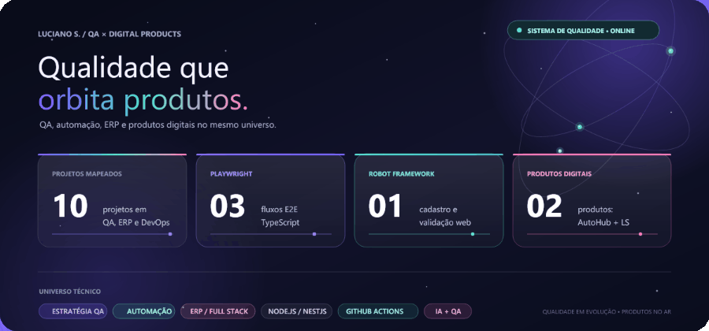

## ✦ QA, Automação e Produtos Digitais

Uma constelação surreal de QA, automação e produtos digitais.

  

### Atividade no GitHub

  

O painel resume os projetos públicos listados neste README. O calendário mostra contribuições públicas reconhecidas pelo GitHub.

## ✦ Expertise

<table>
  <tr>
    <td width="50%"><strong>01 · Estratégia de testes</strong> Análise de requisitos, cenários positivos e negativos, testes exploratórios e regressão.</td>
    <td width="50%"><strong>02 · Automação</strong> Fluxos E2E e API com foco em legibilidade, manutenção e feedback rápido.</td>
  </tr>
  <tr>
    <td width="50%"><strong>03 · IA aplicada ao QA</strong> IA para resumir requisitos, explicar conceitos básicos e apoiar a análise de logs e evidências.</td>
    <td width="50%"><strong>04 · Entrega contínua</strong> BDD, Page Object Model, Git, GitHub e GitHub Actions.</td>
  </tr>
</table>

> A inteligência artificial pode acelerar tarefas de QA, ajudar a explorar casos de teste e organizar informações. A validação humana continua essencial: o QA confere contexto, verifica resultados e toma decisões com base em evidências.

## ✦ Stack de qualidade

  
  
  
  
  
  
  
  
  

## ✦ Projetos

### Qualidade e estratégia de testes

| Projeto | Escopo |
|:--|:--|
| [Desafio Beedoo QA](https://github.com/lucianossf/DESAFIO-QA-BEEDOO-2025) | Análise funcional do módulo de cursos: criação, exclusão e listagem; foco em cobertura e comportamento esperado. |
| [QA Automation DemoQA](https://github.com/lucianossf/desafio-qa-automation-demoqa) | Exercícios de QA para aplicações web e API, com cenários BDD e automação. |

### Automação de testes

| Projeto | Escopo |
|:--|:--|
| [Hospital Playwright Tests](https://github.com/lucianossf/hospital-playwright-tests) | E2E no OpenEMR · Playwright · TypeScript · Page Objects · GitHub Actions. |
| [Retail Playwright Tests](https://github.com/lucianossf/retail-playwright-tests) | E2E para fluxos de varejo e ponto de venda · Playwright · TypeScript. |
| [Playwright SauceDemo](https://github.com/lucianossf/playwright-saucedemo) | Automação E2E com Playwright e TypeScript. |
| [Parabank Web Teste](https://github.com/lucianossf/Parabank_web_teste) | Testes de cadastro e validação de usuário com Robot Framework. |
| [Amazon Web Test](https://github.com/lucianossf/amazon_web_test) | Exercício de testes web criado para prática e desenvolvimento de habilidades em QA. |

### Projetos autorais

#### AutoHub ERP

**Projeto autoral, desenvolvido por mim para um cliente.** Sistema de gestão de veículos com estoque, geração de comprovantes em PDF, painel financeiro e arquitetura multi-tenant.

[Ver apresentação do AutoHub ERP](https://www.linkedin.com/posts/lucianosf_desenvolvimentodesoftware-nestjs-reactjs-activity-7471199990636351488-CO0M)

#### LS Anúncios · plataforma de classificados full-stack

**Projeto pessoal de minha autoria, atualmente em desenvolvimento.**

Plataforma de classificados online em desenvolvimento, com frontend e backend, anúncios, autenticação e área administrativa.

  
  
  
  
  
  
  

| **Camada** | **Escopo** |
|:--|:--|
| **Produto** | Classificados online |
| **Aplicação** | Frontend em TypeScript, JavaScript e CSS |
| **Backend e dados** | Node.js, NestJS, PostgreSQL e TypeORM |
| **Recursos** | Anúncios, autenticação e área administrativa |

### DevOps e aprendizado contínuo

| Projeto | Escopo |
|:--|:--|
| [Curso DevOps Automation](https://github.com/lucianossf/curso-devops-automation) | Repositório de estudos e práticas relacionadas a DevOps e automação de processos. |

